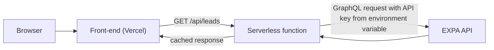

# IID Lead Dashboard (Prototype)

A one-page dashboard that shows leads by application date, the number of leads per status, and the conversion rate. It runs on **mock data** (no real personal data) and is built so a future team can connect it to the real EXPA data without rewriting the UI.

- **Live demo:** https://iid-lead-dashboard.vercel.app/
- **Repository:** https://github.com/angielinaa/iid-lead-dashboard
- **Author:** Maysa Angelina Ridwan, AIESEC in UMM
- **Purpose:** Technical task for the Web Development Team Lead application, AIESEC in Indonesia In-house Development (IID) MT 26.2

> Screenshot: add an image here, for example ``

---

## Features

- Filter leads by **application date** (inclusive date range, with validation if "from" is after "to")
- **Counts per status** and a **conversion rate** (animated ring + status bars)
- Paginated table (15 rows per page), so large lists are never drawn all at once
- **Responsive**: works on mobile and desktop (the table becomes stacked cards on small screens)
- Loading skeleton, clear error and empty states
- Dark mode (follows the device setting) and support for `prefers-reduced-motion`
- Unit tests for the core calculation logic

## Tech stack

| Area | Choice |
| --- | --- |
| Front-end | React + Vite (JavaScript) |
| Styling | Plain CSS with CSS variables (no UI library) |
| Tests | Vitest |
| Hosting | Vercel (auto-deploys from the `main` branch) |
| Optional backend | Serverless function in `api/` (skeleton for the EXPA connection) |

---

## How to run it

### Requirements

- [Node.js](https://nodejs.org/) (current LTS version)
- [Git](https://git-scm.com/)

### Steps

```bash
# 1. Get the code
git clone [PASTE YOUR GITHUB REPO LINK HERE]
cd iid-lead-dashboard

# 2. Install dependencies
npm install

# 3. Start the dev server
npm run dev
```

Open the address shown in the terminal (usually `http://localhost:5173`).

### Other commands

| Command | What it does |
| --- | --- |
| `npm test` | Runs the unit tests |
| `npm run lint` | Checks code style and common mistakes |
| `npm run build` | Creates the production build in `dist/` |
| `npm run preview` | Serves the production build locally |

---

## Project structure

```
iid-lead-dashboard/
├─ api/
│  └─ leads.js              Serverless function skeleton (EXPA connection, not active yet)
├─ src/
│  ├─ components/           UI only: DateFilter, StatsGrid, ConversionRing,
│  │                        FunnelBars, LeadsTable, StatusBadge, Skeleton
│  ├─ data/mockLeads.js     Deterministic mock data generator
│  ├─ hooks/                useLeads (loading/error state), useCountUp (number animation)
│  ├─ lib/leads.js          Pure functions: filter, count per status, conversion rate
│  ├─ lib/leads.test.js     Unit tests for the logic above
│  ├─ services/leadsService.js   The only place that knows where data comes from
│  ├─ App.jsx               Wires state, logic, and components together
│  └─ index.css             All styles and design tokens
├─ .env.example             Environment variable names (no secrets)
└─ README.md
```

### How the data flows

```
mockLeads.js  ->  leadsService.js  ->  useLeads.js  ->  App.jsx  ->  components
(mock data)       (data source)        (loading/error)   (filter + calculations)
```

The calculation logic (`src/lib/leads.js`) is separate from the UI, and the data source (`leadsService.js`) is separate from both. This is deliberate: you can change the data source or the design without touching the logic.

---

## Definitions used in this prototype

**Statuses** (in funnel order): `applied` → `accepted` → `approved` → `realized` → `finished`.

**Application date:** the `appliedAt` field, stored as text in `YYYY-MM-DD` format (compared as text to avoid time zone shifts).

**Conversion rate:** the number of leads that reached **approved or beyond**, divided by the number of leads that reached **applied or beyond**. If there are no leads, the dashboard shows `-` instead of `NaN`.

> **Assumption:** the status list and the conversion definition above are assumptions for this prototype. Confirm them against the official EXPA data before using real numbers, then adjust them as described below.

---

## How a future team can update it

### Change the statuses or their order

1. Edit `STATUSES` and `STATUS_LABELS` in `src/lib/leads.js`.
2. Add a color for each new status in `src/index.css` (for example `.s-newstatus { --c: #123456; }`).
3. Update the weights in `src/data/mockLeads.js` so the mock data includes the new status.
4. Update the tests in `src/lib/leads.test.js`, then run `npm test`.

### Change how conversion rate is calculated

`conversionRate(leads, from, to)` in `src/lib/leads.js` accepts the start and end status. In `src/App.jsx`, change the call, for example `conversionRate(filtered, 'accepted', 'realized')`, and update the label in `ConversionRing.jsx` if needed. Add a test for the new definition.

### Replace mock data with real EXPA data

1. Implement the `TODO` in `api/leads.js`: call the EXPA GraphQL API from the server, fetch **all pages** (pagination), and map each lead to this shape:

   ```json
   { "id": 1, "name": "...", "lc": "...", "status": "applied", "appliedAt": "2026-10-01" }
   ```

   The exact endpoint and field names must come from the official EXPA documentation or schema.
2. In your hosting dashboard (Vercel: Settings → Environment Variables), set:

   | Variable | Value | Where it is used |
   | --- | --- | --- |
   | `EXPA_API_KEY` | the real API key | Server only (`api/leads.js`) |
   | `VITE_USE_API` | `true` | Tells the front-end to call `/api/leads` instead of mock data |

3. Redeploy. No component needs to change, because `leadsService.js` already switches the data source.

> `VITE_*` variables are bundled into the browser code. **Never put secrets in a `VITE_` variable.**

### Other common changes

- **Rows per page:** change `PAGE_SIZE` in `src/components/LeadsTable.jsx`.
- **Colors and spacing:** change the CSS variables at the top of `src/index.css` (`:root`, and the dark mode block).
- **Amount or pattern of mock data:** call `generateMockLeads(count, seed)` with different values (same seed gives the same data, so tests stay stable).
- **A new metric:** add a pure function with a test in `src/lib/leads.js`, then show it in a component.

### Before opening a pull request

```bash
npm test
npm run lint
npm run build
```

Work on a branch, open a pull request, and have at least one other person review it before merging into `main`.

---

## Deployment

The project is connected to Vercel through GitHub. Every push to `main` triggers an automatic build and deploy.

- Build command: `npm run build`
- Output directory: `dist`
- To roll back a bad release: open the **Deployments** tab in Vercel and promote a previous deployment.

---

## Connecting to EXPA in production



The browser never talks to EXPA directly and never sees the API key. The key lives only in the server environment.

## Keeping the EXPA API key secret

- The key is stored only as an environment variable on the hosting platform (`EXPA_API_KEY`).
- It is read only inside `api/leads.js` (server side), never in `src/`.
- `.env` files are listed in `.gitignore`, and only `.env.example` (names, no values) is committed.
- If a key is ever committed or exposed, rotate it immediately and remove it from the repository history.
- Only the fields the dashboard needs should be returned to the browser, to limit exposure of personal data.

## What could go wrong with thousands of leads, and how to handle it

1. **Too much data loaded at once makes the page slow or unresponsive.**
   Handling: the table is already paginated. In production, also filter and aggregate on the server (counts and conversion rate computed server-side), request only the needed fields, and cache responses (the `Cache-Control` header in `api/leads.js`).
2. **The EXPA API is slow, fails, or rate-limits requests, so numbers are missing or wrong.**
   Handling: show a clear error state (already implemented), retry with increasing delays, keep the last successful result as a fallback, and display the "last updated" time so users know how fresh the data is.

---

## Known limitations

- Uses mock data only; no real EXPA connection is active.
- Status names and the conversion definition are assumptions until confirmed with the real EXPA schema.
- `api/leads.js` is a skeleton and returns `501 Not Implemented`.
- No authentication yet. Real lead data contains personal information, so access control must be added before showing it publicly.

## License

[CHOOSE A LICENSE OR REMOVE THIS SECTION]
